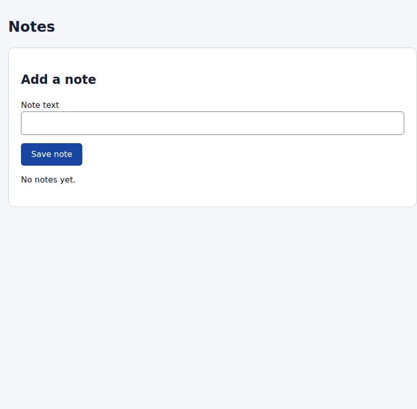
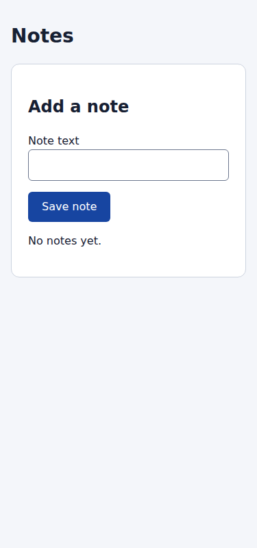
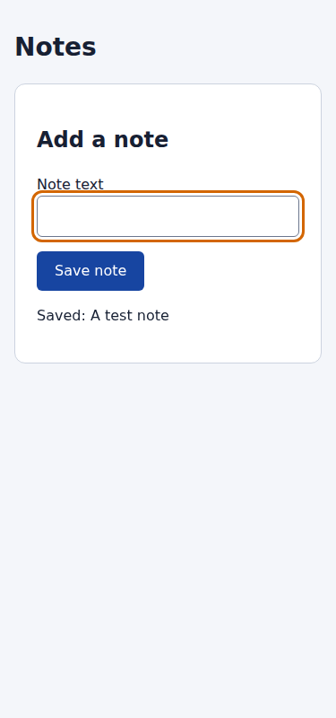

# W2 acceptance — 2026-10-14

Публикация: [v1.52.0](../../releases/v1.52.0.md), 2026-10-16; exact source/catalog и published smoke —
[release evidence](../../releases/v1.52.0-results.json). Ниже сохранена
историческая приёмка initial checkpoint с её исходной версией и ограничениями.

Status: committed/pushed, complete CI PASS, fresh CLI qualification accepted within the bounds below; unreleased.
Implementation [911387c](https://github.com/StenHigh/prifly-aif-workflows/commit/911387ce6cc42e2ec53164f221ce4045bd05b56b),
[complete CI](https://github.com/StenHigh/prifly-aif-workflows/actions/runs/38631695137).
Standalone [aif-ui-ux](../../../aif-ui-ux/README.md), initial version 1.0.0.
Released Linux/amd64 Pri-Fly **0.13.76**, binary SHA-256
`03ac382112a12001ea9e2a86e5a20db2d5e24ec79ce5339f6257c473d0f3322d`.
No existing workflow folder, including W1, changed.

| Criterion | Evidence / result |
|---|---|
| A1 | Read-only package preview validates and shows checks/requiredness/scenarios/scope/environment; native questionnaire prepare seals the exact input digest and execution/effect boundaries. Native summary does not render a new domain form; this is explicitly a companion preview. Excluded reader remains a recorded skip. |
| A2 | Actual Playwright **1.64.1**, Chromium **156.0.8078.4**: 1280×800 desktop, 375×800 mobile and keyboard/form flow. [Browser results](browser-results.json) record actual observations separately from deterministic verdicts. [Live current Codex-app reports](live-observations.json) add shared-session screenshot inspection. [Fresh CLI qualification](fresh-cli-observations.json) records four separate actual readers, actual browser/screenshot findings and exact native gates; all reports submitted unchanged. |
| A3 | Required missing browser/server → partial; optional ignore → warnings/succeeded, stop → partial. Code evidence substituted for browser is blocked. Actual missing-server fixture performs zero browser checks. |
| A4 | Declared backend-only scope + reason produces not_applicable; frontend cannot change applicability because the browser is missing. Unit/runtime negative cases check this distinction. |
| A5 | Real mobile overflow: scrollWidth 816 > viewport 375. Real save flow lacks confirmation after loading. Both detected as failed; source Run partial. Separate deterministic owner repair, fresh capture/server/UI/UX → succeeded. Root Codex-app also inspected before/after images and submitted live reports; no AI author repair is claimed. |
| A6 | Unique loopback ports, browser contexts and owned sessions; unit shared lease refuses another job. A second Run cannot acquire declared quality resource while the first Attempt holds it; resource_busy creates a waiting Run before returning an error, and the probe discovers/cleans that exact Run. Resources scope Attempts; runner lease protects gaps across readers. |
| A7 | Setup/release have explicit external_write + reconcile_required, reviewers none/read_only. Exact owner/session cleanup checked; interrupted release becomes partial/reconcile_required. Cancellation bypasses tail and operator performs predeclared scoped cleanup, preserves candidate and resumes fresh quality. Transition fixture distinguishes release_required and reconcile_required; no blanket release. |
| A8 | Positive/negative compile for codex-cli/codex-app/claude-code on released compiler. Actual Codex-app shared observation plus Codex CLI **0.162.1**, four unique fresh sessions with require_separate_session=true. workspace-write sandbox retained, per-command escalation auto-reviewed. Earlier [unavailable observation](host-unavailable.json) retained as history. Different model and live Claude not established. |

Tests: 14 product/unit/lifecycle cases and two RED canaries (scenario coverage
and exact cleanup identity); released static7/version3/derive/compile and
compatibility gates PASS. [Full runtime matrix](runtime-results.json): 20 cases
PASS (18 routes plus two additional host bindings). Unchanged W1 regression:
25 cases PASS. Actual browser matrix: four cases PASS; current shared host:
one defect/repair case, two Runs, four live reader deliveries. Fresh CLI:
one defect/repair case, two Runs, four unique sessions, unedited reports;
source failed/partial → resumed warnings/succeeded (unavailable independent
model mapping only). Candidate/authority unchanged by readers; owned cleanup PASS. CI includes both
synthetic runtime and real browser fixture; live host usage is manual.

## Real visual and flow observations

The mobile page initially forces an 800px panel outside the 375px viewport:

Fresh browser inspection after separate repair shows a 343px panel, 16px side
margins and no horizontal overflow:

Keyboard focus stays visible and the form confirms the submitted test note:

## Bounds and remaining qualification

Environment receipts/source binding, narrative evidence and session/model
fields remain adapter/host declarations. Engine acceptance validates their
consistency and current Git candidate, not deployment attestation or visual
truth. A different origin with identical bytes is not inferred automatically.
The test browser adapter handles only the declared notes fixture; real projects
supply their own browser/setup/cleanup contract and design references.

The initial sandbox-only CLI observation produced no report. Auto-review again
rejected danger-full-access after the user's permission because prompt-only
scope does not technically bound system/credential/network access. No blanket
override was executed. The supported --approve-for-me mode preserves the
workspace-write sandbox and reviews eligible per-command escalation; the exact
fixture commands were approved and all four fresh CLI readers completed.
[Official approval settings](https://learn.chatgpt.com/docs/config-file/config-reference).

The first successful shell session exposed a [protocol negative](protocol-negative.json):
native profile key unavailable_reason was invalid, UI evidence also mixed a UX
scenario and added selectors to URL locator. Its submission was rejected, kept
unchanged and the fixture cleaned. The standalone bridges now carry the full
lens/check, observation JSON, exact URL and literal native reason contract.
Neutral probe guidance was corrected; fresh sessions reran without altering
any host finding/verdict/report. Four unique accepted thread IDs and source/
resumed gate digests are in fresh-cli-observations.json. Fresh conversation
is established; independent model selection is still unavailable. Claude live
and actual private consumer qualification remain deferred.

[Environment guide](../../product-review-environment.md) resolves the generic
contract/example portion of issue #2. Actual PHP/private consumer provisioning
has not been exercised; issue #2 stays open for consumer qualification. No new
Pri-Fly change or issue is required. Classic/profiled remain the reference
workflow. W3 can consume these standalone components after this qualification;
W5 still requires its implementation/parallel acceptance; fresh sequential
readers here are evidence for its prerequisite, not parallel qualification.
